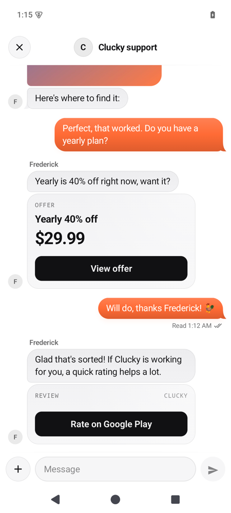
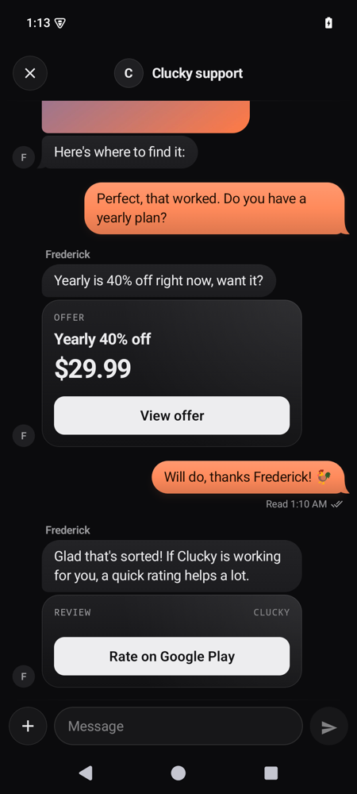
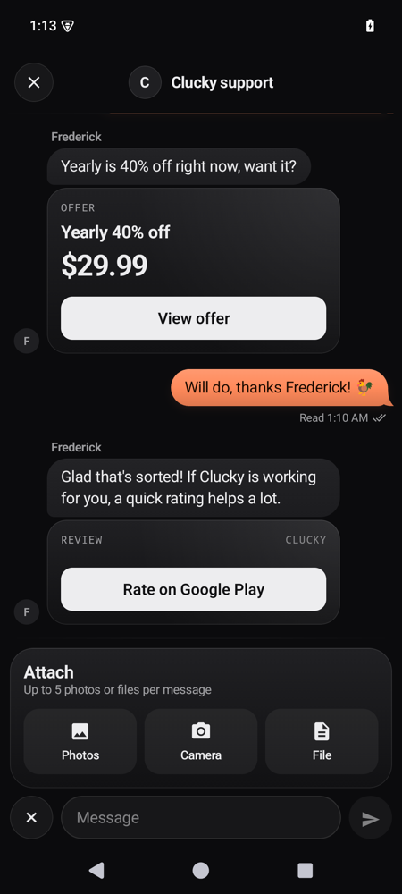
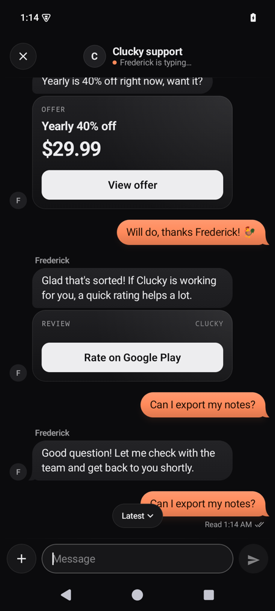
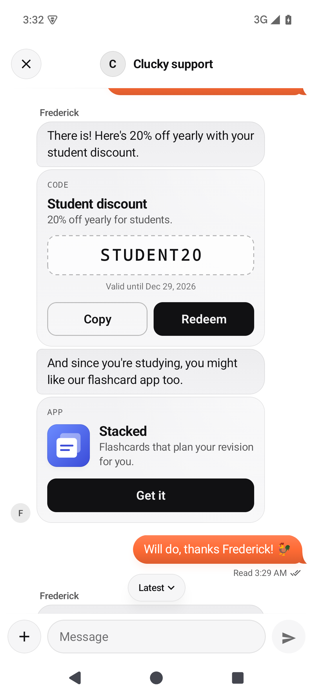
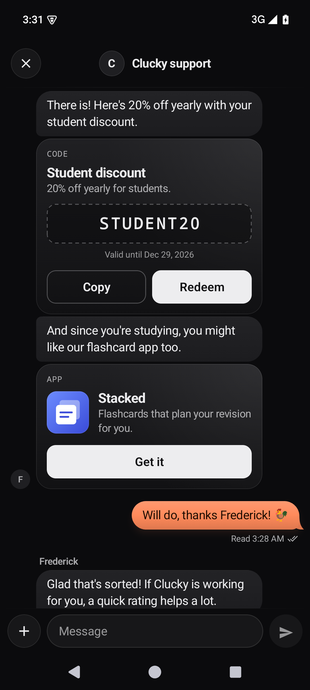

# Support Yaps for Android

In-app support chat for Android apps. Your users message your team from inside the app, with photos
and files, replies arrive live or by push, and your team answers from the inbox at
[support.yaps.ai](https://support.yaps.ai) or the operator app.

- Kotlin first, Java friendly. Jetpack Compose UI plus a ready-made `SupportActivity` for View apps.
- minSdk 24, compiled against SDK 36 (the library sets no target SDK; the sample targets 36). Edge-to-edge, predictive back, IME insets, TalkBack, RTL,
  font scaling, dark theme, and 22 languages.
- No Firebase dependency: your app forwards the FCM token and data messages.
- No storage or camera permissions: the system Photo Picker, the camera app and the document picker do the work.

| Light | Dark | Attachment tray | Typing |
|---|---|---|---|
|  |  |  |  |

*(Screenshots are from `:sample` on an API 35 emulator, running against its in-process fake backend.)*

## Install

The library is published through JitPack from
[github.com/richawo/yaps-support-android](https://github.com/richawo/yaps-support-android).

```kotlin
// settings.gradle.kts
dependencyResolutionManagement {
    repositories {
        google()
        mavenCentral()
        maven("https://jitpack.io")
    }
}

// app/build.gradle.kts
dependencies {
    implementation("com.github.richawo:yaps-support-android:2.0.0")
}
```

The library ships consumer R8 rules, so release builds need no extra configuration.

## Quick start

```kotlin
class App : Application() {
    override fun onCreate() {
        super.onCreate()
        YapsSupport.configure(this, appId = "app_123")   // your App ID from the inbox
    }
}
```

`configure` registers the device in the background and fetches your published appearance. No
conversation exists until the user opens the chat or sends their first message.

When your user signs in (and on every launch while they are signed in):

```kotlin
YapsSupport.identify(userId = user.id, name = user.name, email = user.email)
YapsSupport.setMetadata(mapOf("plan" to "pro", "build" to BuildConfig.VERSION_NAME))  // replaces all metadata
```

When they sign out:

```kotlin
YapsSupport.logout()   // revokes this device's token, clears local history, drafts and pending sends
```

### Compose

```kotlin
var showSupport by rememberSaveable { mutableStateOf(false) }

if (showSupport) {
    SupportChat(onClose = { showSupport = false })   // full screen, handles insets and predictive back
}

// Unread badge
val unread by YapsSupport.unreadCount.collectAsStateWithLifecycle()
BadgedBox(badge = { if (unread > 0) Badge { Text("$unread") } }) {
    IconButton(onClick = { showSupport = true }) { Icon(Icons.Outlined.Email, "Support") }
}
```

`SupportChat` draws edge-to-edge and pads for the status bar, navigation bar, display cutout and
keyboard itself. Insets your layout already consumed are respected, so it also works inside a
`Scaffold` or a full-height bottom sheet.

### Views (or anywhere with a Context)

```kotlin
YapsSupport.openChat(context)    // starts SupportActivity
YapsSupport.closeChat()          // closes it (and any visible SupportChat)
```

Java:

```java
YapsSupport.configure(this, "app_123");
YapsSupport.identify("u_42", "Ada", "ada@example.com");
YapsSupport.openChat(activity);
YapsSupport.addEventListener(event -> Log.d("Support", event.toString()));
YapsSupport.deleteDataAsync(error -> { /* null on success */ });
```

## Push notifications (FCM)

Support Yaps sends **data** messages so the SDK controls the channel, grouping and tap target. You
forward two things: the token and incoming messages.

### 1. Upload your Firebase service account in the inbox

1. Firebase console → your project → **Project settings → Service accounts → Generate new private key**.
   This downloads a JSON file.
2. Inbox → **App settings → Push → Android (FCM)** → upload that JSON.
3. Press **Send test push** with a test device selected to confirm it works.

The key only lets Support Yaps send messages to your app's tokens. Support Yaps uses FCM as a
transport and nothing else from Firebase.

### 2. Forward tokens and messages

Add `com.google.firebase:firebase-messaging` to **your app** (the SDK doesn't depend on it) and a service:

```kotlin
class AppMessagingService : FirebaseMessagingService() {

    override fun onNewToken(token: String) {
        YapsSupport.setPushToken(token)               // provider defaults to PushProvider.FCM
    }

    override fun onMessageReceived(message: RemoteMessage) {
        if (YapsSupport.handlePush(this, message.data)) return   // ours: shown in the "Support" channel
        // …your own pushes
    }
}
```

```xml
<service
    android:name=".AppMessagingService"
    android:exported="false">
    <intent-filter>
        <action android:name="com.google.firebase.MESSAGING_EVENT" />
    </intent-filter>
</service>
```

Also forward the current token once at startup, since `onNewToken` only fires when it changes:

```kotlin
FirebaseMessaging.getInstance().token.addOnSuccessListener { YapsSupport.setPushToken(it) }
```

### What `handlePush` does

- Returns `false` for anything without `support == "1"`, so you can chain your own handling.
  `YapsSupport.isSupportPush(data)` checks without handling.
- Updates `unreadCount` from the payload's badge, or fetches it when the push has none
  (`updatesAppBadge = false`).
- Shows a notification in a **Support** channel the SDK creates, grouped per conversation, unless
  the chat is on screen (then it refreshes the thread instead).
- A tap opens `SupportActivity` directly through a `PendingIntent`, stacked on your launcher activity
  so Back returns to your app. There is no trampoline, which Android 12+ blocks.

Set `YapsSupport.notificationIcon = R.drawable.ic_stat_support` to use your own monochrome icon.

### Badge

By default support notifications carry the unread count (`setNumber`, which launchers that show
counts use for the icon badge). If your app owns the badge, turn that off:

```kotlin
YapsSupport.updatesAppBadge = false
```

The SDK then leaves the count off its notifications and tells the server (`badgeEnabled: false` in
`PATCH /v1/sdk/device`, sent right after registering and whenever the value changes), which stops
putting `badge` in this device's pushes. `unreadCount` keeps working; read it to draw your own badge.

### Notification permission (Android 13+)

The SDK declares `POST_NOTIFICATIONS` but **never asks for it**. Ask when it makes sense, for
example right after the user sends their first message:

```kotlin
YapsSupport.events.collect { if (it is SupportEvent.MessageSent) YapsSupport.requestNotificationPermission(activity) }
```

`requestNotificationPermission` returns `true` when notifications are already allowed.

## Identity verification

Labels from `identify(userId, name, email)` help your team but anyone could claim any `userId`.
To prove who the user is, mint a short-lived JWT **on your server** with the app's identity secret
(`ids_…`, inbox → App settings → Identity) and pass it to the SDK:

```js
// Node, on your server
import jwt from "jsonwebtoken";
const supportToken = jwt.sign(
  { user_id: user.id, email: user.email, name: user.name },
  process.env.SUPPORT_IDENTITY_SECRET,
  { algorithm: "HS256", expiresIn: "1h" },
);
```

```kotlin
YapsSupport.identify(token = supportTokenFromYourServer)
```

- Claims: `user_id` (required), `exp` (required), optional `email`, `name`, `nbf`. HS256 only.
- The token is held in memory only. Never ship the secret in your app.
- Verified users share **one conversation across their devices** in this app (App ID). Your other
  apps keep their own conversations; the inbox shows them under "Also uses".
- A rejected token emits `SupportEvent.IdentityRejected(code)` and the chat keeps working unverified.
- With **Verified users only** turned on in the inbox (App settings → Identity), unverified users can read but see
  "Sign in to send messages." until a valid token arrives.

## Paywalls and offer cards (RevenueCat example)

Agents can send an offer card for any paywall your app reports. Tapping it calls your `onPaywall`
handler; you present the purchase screen and own the purchase.

```kotlin
YapsSupport.paywalls = listOf(
    SupportPaywall(
        id = "yearly_offer",                       // [A-Za-z0-9_.-], ≤ 64 chars; up to 20 paywalls
        title = "Yearly 40% off",
        products = listOf(SupportPaywallProduct(id = "pro_yearly", price = "$29.99", period = "P1Y", trial = "P1W")),
    ),
)

// Hide paywalls that don't apply right now (cards for them show "No longer available").
YapsSupport.paywallAvailability = { _ ->
    Purchases.sharedInstance.awaitCustomerInfo().entitlements["pro"]?.isActive != true
}

// Present it. With RevenueCat Paywalls, map the paywall ID to an offering.
YapsSupport.onPaywall = { paywallId ->
    lifecycleScope.launch {
        val offering = Purchases.sharedInstance.awaitOfferings()[paywallId]
        if (offering != null) paywallActivityLauncher.launch(offering)
    }
}

// After a purchase, re-report what's available.
YapsSupport.refreshPaywalls()
```

For subscription context in the inbox (trial, renewal, billing issues), add the RevenueCat webhook
from inbox → App settings → Integrations, and use the same app user ID in RevenueCat as the
`userId` you pass to `identify`. Superwall, Adapty and Google Play RTDN work the same way.

On Android a discount means a Play subscription offer, not a link to a web checkout.

## Review cards

Review cards open your Play listing (`market://details?id=…`, falling back to the Play web page).
They never call the In-App Review API: Google forbids calling it from a button because its quota can
silently swallow the prompt. Keep the in-app review sheet for natural moments in your own flow.

## App promo cards

Agents (and automations) can recommend another app from your organisation. The card shows the app's
icon, name, a one-line pitch and **Get it**, which opens its Play listing (`market://details?id=…`,
falling back to the Play web page when the Play Store isn't installed).

- If the user already uses that app (a verified user with the same user ID there), the card says
  **You already have it** and has no button.
- If the promoted app has no Android listing, the message shows as plain text.
- Tapping **Get it** emits `SupportEvent.AppPromoOpened(messageId, appId)`.

Nothing to set up in your app; promotable apps and the pitch are configured in the inbox.

| Light | Dark |
|---|---|
|  |  |

*(A code card and an app promo card in `:sample` on an API 35 emulator.)*

## Code cards

Agents can send a discount or promo code from a code campaign (a shared code, or one-time codes
from a pool, one per customer).

- The code sits in a monospaced, selectable box with **Copy** and **Redeem**. On Android, Redeem
  opens `https://play.google.com/redeem?code=…`, so Play promo codes for your subscriptions land in
  the Play redeem flow with the code filled in.
- Copy uses the system clipboard with a haptic tick. Android 13+ shows its own copy confirmation;
  on older versions the button turns into **Copied** for a moment.
- A code for another platform shows Copy plus a hint (**Redeem on iPhone** / **Redeem on the web**).
- Past its expiry the code is struck through and marked **Expired**, with no buttons. A card on
  screen turns expired at the moment it lapses.
- TalkBack reads the code one character at a time.
- Copy emits `SupportEvent.CodeCopied(messageId, campaignId)` and Redeem emits
  `SupportEvent.CodeOpened(messageId, campaignId)`. Both are recorded for the campaign's stats.

## Link cards and screens

Agents can send a link card: the message text with one button under it. The button opens

- a web page, or an email, phone or text message link (`ACTION_VIEW`; only `https:`, `mailto:`,
  `tel:` and `sms:` links open, anything else is refused),
- your app's page in system settings (`Settings.ACTION_APPLICATION_DETAILS_SETTINGS`), for example to
  turn notifications back on,
- or a screen in your app that you register:

```kotlin
// Application.onCreate (or whenever the list changes)
YapsSupport.screens = listOf(
    SupportScreen(id = "edit_profile", title = "Edit profile"),      // [A-Za-z0-9_.-], ≤ 64 chars; title ≤ 60; up to 50
    SupportScreen(id = "restore_purchases", title = "Restore purchases"),
)

// Navigate. The SDK has already closed the chat it presented (as closeChat() does).
YapsSupport.onScreen = { screenId -> navController.navigate(screenId) }
```

Screens are reported to the server after registering and whenever you set `screens`, so agents
can only pick screens this device can open. Invalid IDs and repeats are dropped. A screen card is
**No longer available** when its screen isn't in your current list or `onScreen` is `null`, and so is
any link the server marks unavailable.

Once the link has opened (an app took it, or `onScreen` was called) the SDK emits
`SupportEvent.LinkOpened(messageId, linkId)` (`linkId` is `null` for a one-off link that wasn't
saved in the inbox) and records it for the link's stats. A link no app can open does neither.

Links in plain message text are tappable too: `https://` URLs, without trailing punctuation.

## Automations

```kotlin
YapsSupport.track("paywall_declined")                    // only names listed in the app's tracked events are sent
YapsSupport.track("onboarding_completed", opensChat = true)  // an automation may open the chat
```

## Appearance

Everything is optional. Values published from the inbox win field by field (**remote > local > default**)
and apply the next time the chat opens, never mid-conversation.

```kotlin
YapsSupport.appearance = SupportAppearance(
    accent = SupportColor(light = 0xFFFF6B35.toInt(), dark = 0xFFFF8A5B.toInt()),
    onAccent = SupportColor(0xFFFFFFFF.toInt(), 0xFF1A0A00.toInt()),
    title = "Wakely support",
    welcomeTitle = "How can we help?",
    cornerStyle = SupportCornerStyle.ROUND,
    colorScheme = SupportColorScheme.SYSTEM,
    useDynamicColor = true,      // Material You (Android 12+) replaces the SDK defaults only
)
YapsSupport.usesRemoteAppearance = true   // default
YapsSupport.languageOverride = "es"       // SDK strings, layout direction and translations; null follows the system
```

## Events

```kotlin
YapsSupport.events.collect { event ->
    when (event) {
        SupportEvent.ChatOpened, SupportEvent.ChatClosed -> {}
        is SupportEvent.MessageSent -> {}
        is SupportEvent.MessageReceived -> {}
        is SupportEvent.ImageSent -> {}
        is SupportEvent.ReviewOpened -> {}
        is SupportEvent.PaywallOpened -> {}
        is SupportEvent.AppPromoOpened -> {}
        is SupportEvent.CodeCopied -> {}
        is SupportEvent.CodeOpened -> {}
        is SupportEvent.LinkOpened -> {}
        SupportEvent.DataDeleted -> {}
        is SupportEvent.IdentityRejected -> {}
    }
}
```

`YapsSupport.isChatOpen: StateFlow<Boolean>` tells you whether a chat is showing.

## API reference

| API | What it does |
|---|---|
| `configure(context, appId, baseUrl = "https://support.yaps.ai")` | Set up once in `Application.onCreate`. |
| `isConfigured`, `version`, `logLevel` | State, SDK version, Logcat verbosity (`YapsSupport` tag). Tokens and message text are never logged. |
| `identify(userId, name, email)` / `identify(token)` | Unverified labels / verified identity (HS256 JWT). |
| `setMetadata(map)` | Replaces all metadata (30 keys, values ≤ 512 chars). |
| `logout()` | Ends the session on this device; server history is kept. |
| `suspend deleteData()` / `deleteDataAsync(callback)` | Deletes the registration (and the customer's data if this was their last device). |
| `SupportChat(modifier, onClose)` | Compose chat. |
| `openChat(context)` / `closeChat()` / `SupportActivity.intent(context)` | Activity chat. |
| `unreadCount`, `isChatOpen` | `StateFlow`s. |
| `appearance`, `usesRemoteAppearance`, `languageOverride`, `notificationIcon` | Look and language. |
| `events`, `addEventListener` / `removeEventListener` | Things that happen. |
| `paywalls`, `onPaywall`, `paywallAvailability`, `refreshPaywalls()` | Offer cards. |
| `screens`, `onScreen` | Screens that link cards can open. |
| `track(name, opensChat = false)` | Automation events. |
| `setPushToken(token, provider = FCM)`, `handlePush(context, data)`, `isSupportPush(data)`, `requestNotificationPermission(activity)` | Push. |
| `updatesAppBadge` | Whether notifications and pushes carry the unread count (default `true`). |

## How it behaves

- **Live updates.** A WebSocket is open only while the chat is on screen (`hello` with the last seen
  sequence, `ack`, `state`, `typing`, a `ping` every 25 s) and reconnects with jittered backoff
  (1, 2, 4, 8, 16, 30 s ±20 %). If the socket is refused, the chat polls instead. In the background
  the SDK relies on push.
- **Sending.** Every message goes through a durable outbox (`noBackupFilesDir`, JSON) first, with a
  ULID client ID the server deduplicates on. Retries back off exponentially; after 5 attempts or a
  final 4xx the message shows **Not delivered** with **Retry** and **Delete**. If the app goes to the
  background mid-send, a WorkManager job finishes delivery once there is a network.
- **History.** The last 200 messages are cached for instant, offline display; older pages load as you scroll up.
  Drafts are kept across launches.
- **Photos and files.** Photos are downscaled to ≤ 2,048 px and ≤ 1 MiB JPEG with EXIF rotation
  applied; files can be PDF, TXT, ZIP or LOG up to 10 MiB; up to 5 per message, with upload progress.
- **Security.** The device token is encrypted with an AES-GCM key in the Android Keystore. On a
  `401` the SDK registers again. The identity JWT stays in memory.
- **Translation.** When the team writes in another language, the user sees the translation for
  their language and the original otherwise.

### Dependencies

OkHttp, kotlinx.serialization, coroutines, Coil 3, Compose (Material 3), AndroidX Activity,
Lifecycle, Core, ExifInterface and WorkManager. No Firebase and no database of its own
(WorkManager brings Room in transitively for its own job store).

## Play Console: Data safety answers

What the SDK collects, so you can fill in **App content → Data safety**. Support Yaps acts as your
service provider, so this data is **collected**, not **shared**. All of it is **encrypted in transit**
(HTTPS/WSS), and users can **request deletion** (call `YapsSupport.deleteData()`, or delete the customer in the inbox).

| Data type (Play category) | When | Purpose | Optional? |
|---|---|---|---|
| Personal info → **Name, Email address, User IDs** | Only if you call `identify` | App functionality (customer support) | Yes, user-provided or set by you |
| Messages → **Other in-app messages** | Messages the user sends | App functionality | Yes |
| Photos and videos → **Photos** | Photos the user attaches | App functionality | Yes |
| Files and docs → **Files and docs** | Files the user attaches | App functionality | Yes |
| App activity → **Other actions** | Event names you pass to `track` | App functionality (automations) | Yes |
| Device or other IDs → **Device or other IDs** | FCM token and the SDK's registration ID | App functionality (push) | No |
| App info and performance | Not collected | | |
| Location, contacts, financial info, health, web browsing | Not collected | | |

Also declare whatever you send through `setMetadata` (for example a plan name), and **Purchase history**
if you connect RevenueCat, Superwall, Adapty or Google Play webhooks. Device model, OS version,
app version, locale and time zone are sent with the registration to help your team; Google treats
these as diagnostics only if you collect crash or performance data, which the SDK doesn't.

Permissions the SDK adds: `INTERNET`, `ACCESS_NETWORK_STATE` and `POST_NOTIFICATIONS` (requested only
when you call `requestNotificationPermission`). No storage, camera or contacts permissions.

## Sample app

`:sample` runs the whole SDK against an in-process fake backend (MockWebServer speaking the real
protocol, including the WebSocket), so it works offline with no account. Send a message and
"Frederick" reads it, types and replies. The seeded conversation includes an offer card, a code
card, an app promo card, two link cards (a registered `edit_profile` screen and a web page) and a
review card.

```bash
./gradlew :sample:installDebug
adb shell am start -n ai.yaps.support.sample/.MainActivity --ez open_chat true   # straight into the chat
adb shell am start -n ai.yaps.support.sample/.MainActivity --ez embedded true    # the Compose version
```

## Development

```bash
./gradlew :yaps-support:testDebugUnitTest :yaps-support:assembleRelease :sample:assembleDebug
```

Unit tests decode every conformance fixture in `../../protocol/fixtures` (or the copy in `yaps-support/src/test/fixtures` outside the monorepo) (wired in through a system
property, so the shared fixtures stay the single source of truth) and cover unknown fields and
frames, the translation rule, push recognition, the outbox (dedupe, backoff, failure, process death),
appearance precedence, review and app promo store links (`market://` with the https fallback), app
promo and code card states (installed, unavailable, expired, available), link card availability
per target and the allowed URL schemes, screen validation, the `screens` and `badgeEnabled` device
updates, links in message text, card events and action receipts, and the REST client. Compose previews live in
`yaps-support/src/main/kotlin/ai/yaps/support/ui/Previews.kt`.

Strings are generated for all 22 locales by `scripts/gen_strings.py`. Add a key there, then run
`python3 scripts/gen_strings.py yaps-support/src/main/res`.

### Design

The chat UI is built from the Design for AI briefs `pro/mobile-chat`, `pro/mobile-attachment-tray`
and `free/chat-thread`: 14 dp sides, a 34 dp avatar gutter, 16 dp between groups and 3 dp within,
radius 20 with 7 dp grouped corners and the brief's tail, one accent (the host's) used only on your
bubbles, the send button and live dots, neutral ink everywhere else, and motion that explains
something: sent bubbles fly out of the composer on a spring, replies rise, presses squish. With
**Remove animations** turned on in system settings, every entrance becomes a 150 ms fade.
Colours always come from your appearance settings (or Material You), never from the Yaps brand.
